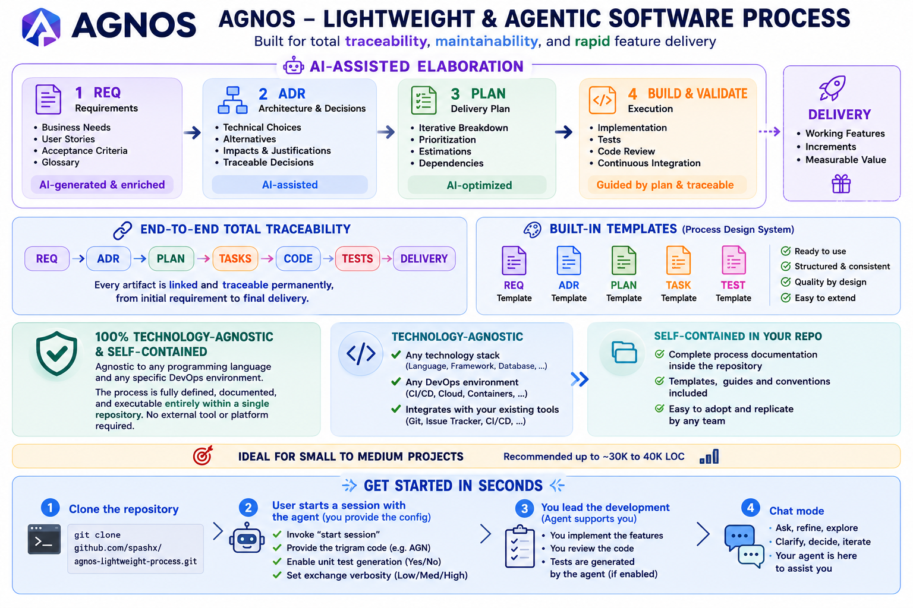

# AGNOS — Lightweight Software Engineering Process for Agentic AI

**AGNOS is an ultra-lightweight engineering process for tiger teams and solo experts who build
software with agentic AI.

AGNOS is a lightweight, tooled process for *AI-native* development teams (pods of a few people, or solo). Requirements, decisions, tasks, code and commits carry the same identifiers: the work stays explainable.
AGNOS It puts two things first — **end-to-end traceability** and **deterministic indexing** — so that AI-driven development stays controllable as the codebase grows.
The process can be monitored with the built-in AGNOS Performance Center application.

> This README is an overview for human readers and is not normative. The AI agent executes the
> process from [`plugins/agnos/skills/agnos-instructions/SKILL.md`](plugins/agnos/skills/agnos-instructions/SKILL.md).

<!-- This page addresses the plugin user; the guide holds the session and the concepts,
COMPATIBILITY.md the tools and systems checked, CONTRIBUTING.md the map of this repository. -->

---

## What AGNOS Provides

| Component | What it does |
|---|---|
| **The process** | Requirements (EARS) → Architecture Decision Records → Plans and tasks (Gherkin), each artifact with a unique ID and explicit links to the others. |
| **`agnos-init`** | Adds AGNOS to a project: one explicit call completes its `CLAUDE.md` and `AGENTS.md` with a delimited block, leaving every other byte untouched, creates its `agnos-process/` folders and writes into them the guide `AGNOS-GETTING-STARTED.md` and `VERSION.txt`. |
| **`agnos-index`** | Deterministically regenerates `agnos-process/process.idx.md`, the index of every artifact (ID, line range, status, title), so the agent reads only what it needs. |
| **`agnos-git-workflow`** | One session branch, one commit per task, with the artifact IDs validated and written into every commit message: the traceability is unique and permanent in the Git history. |
| **`agnos-design-system`** | Template and procedure for the design system every UI project defines before its first UI requirement: all visual values become traceable tokens. |
| **`agnos-self-improvement`** | Turns the session's friction metrics into rules: the improvement goes into the rules file the project declares, one theme per iteration, within a line budget its scripts measure. |
| **`agnos-perf-center`** | Generates a complete application, opened from disk, to monitor the process's execution on a project and explore its traceability matrix — coverage, quality score and grade, interactive graph — down to the implementing functions and their call graph, and, with `--history`, who (humans and agents) changed each requirement and its code over time. |

**Delivered as:** one marketplace holding the plugin `agnos`, for Claude Code, GitHub Copilot and OpenAI Codex.

---

## Requirements

<!-- Read from the skills, each states its own needs -->

| Need | Windows | Linux, macOS | Used by |
|---|---|---|---|
| An AI coding tool | Claude Code, GitHub Copilot (CLI or VS Code) or OpenAI Codex | The same | Every skill |
| git | Git for Windows | git | `agnos-git-workflow`; `agnos-perf-center --history` |
| A shell for the scripts | Windows PowerShell 5.1, built into Windows; PowerShell 7 is not needed | bash, with the usual `grep`, `awk`, `od` and `cmp` | `agnos-init`, `agnos-index`, `agnos-git-workflow` |
| Python 3.9 or later, standard library only | `python` | `python3` | `agnos-perf-center` only |
| A current browser, and the network once | The page loads its libraries from cdnjs the first time it opens | The same | The page of `agnos-perf-center` |

**Optional — the call graph.** `agnos-perf-center --call-graph` also needs the tree-sitter packages listed in the skill's
`requirements-callgraph.txt`. They are not fetched automatically: install them once with
`pip install -r requirements-callgraph.txt` from the skill's folder, or let the agent do it with your approval. They are
prebuilt wheels, so no compiler is needed. Without them, the page is written all the same, without functions.

**GitHub Copilot in VS Code.** Keep on two settings, both on by default: `chat.useAgentsMdFile`, which reads the AGNOS
block of your project's `AGENTS.md`, and `chat.useAgentSkills`, which lets that block invoke the `agnos-instructions`
skill. `chat.useClaudeMdFile`, on by default too, also reads the same block from `CLAUDE.md`, which does no harm. These
settings apply to VS Code's Local sessions.

The tools and systems AGNOS was checked on are listed in [COMPATIBILITY.md](COMPATIBILITY.md).

---

## Getting Started

**1. Install the plugin**, where `<marketplace>` is this marketplace's folder or Git address:

| Tool | Commands |
|---|---|
| Claude Code | `claude plugin marketplace add <marketplace>`, then `claude plugin install agnos@agnos-marketplace` |
| GitHub Copilot CLI | `copilot plugin marketplace add <marketplace>`, then `copilot plugin install agnos@agnos-marketplace` |

**2. Ask your agent to call the `agnos-init` skill once**, from your project's root. This step is required: until it runs, an
agent in your project does not know about AGNOS. Your own content stays as it is: AGNOS only owns the lines
between its `AGNOS:BEGIN` and `AGNOS:END` markers. To update a project after AGNOS changes, call it again.

**3. Open a new conversation in your tool**, so that it reads the block, **and in it ask the agent to start an AGNOS session.**

**Then read `agnos-process/AGNOS-GETTING-STARTED.md`**, which `agnos-init` wrote into your project's process folder, beside
`agnos-process/VERSION.txt`, the AGNOS version installed: a complete worked session, what you type and what comes back, and the
concepts behind it. Its source is
[the skill's template](plugins/agnos/skills/agnos-init/assets/templates/AGNOS-GETTING-STARTED.md).

### Keeping the Process in the Agent's Context

<!-- From the tools' documentation read on 2026-11-14; what it leaves unsaid is stated as such -->

The block that `agnos-init` writes holds no process: it orders the agent to invoke the `agnos-instructions` skill, and that
skill holds the whole process. Your tool reloads `CLAUDE.md` and `AGENTS.md` whenever it needs them. **A skill is not reloaded:**
once invoked, it lives only in the conversation, so whatever clears or shortens the conversation can remove the process, with no
error and no warning. The agent then goes on working, but without some or all of the AGNOS rules.

| Event | Claude Code | GitHub Copilot |
|---|---|---|
| **New conversation, session start** | `CLAUDE.md` is loaded; the block makes the agent invoke the skill | `AGENTS.md` is included (and `CLAUDE.md` with `chat.useClaudeMdFile`); the block makes the agent invoke the skill |
| **Clear** (`/clear`, new chat) | The skill is gone, `CLAUDE.md` is loaded again: the block makes the agent invoke the skill again | The same, in the new chat |
| **Automatic compaction** (the conversation is summarised when the context fills) | `CLAUDE.md` is re-read from disk. The skill is re-attached, **but only its first 5,000 tokens**, within 25,000 tokens shared by every skill invoked. The process is about 7,000 tokens: **its end is cut**, which holds the testing rules, the anti-patterns and the Error Recovery Protocol | Long chats are summarised. **The documentation does not say** what happens to a skill already loaded: assume it can be lost |
| **Manual compaction** (`/compact`) | `CLAUDE.md` is re-read from disk. **The documentation does not say** whether the skill is re-attached the same way: assume its end is cut too | No equivalent command |

**What the risks are.**

1. **A partial process.** After an automatic compaction in Claude Code, the agent keeps the beginning of the process and loses its
   end. It may still tier tasks and cite IDs, while no longer writing tests first or stopping after a failed fix.
2. **A silent loss.** Nothing tells you the process was cut or dropped. The work looks normal until a rule is not applied.
3. **Uncovered behaviour.** What GitHub Copilot does with a skill when it summarises, and what Claude Code does on `/compact`, are
   not documented: AGNOS cannot guarantee them.

**What you do.**

1. **Run one AGNOS session per conversation.** Between two sessions, clear the conversation, then ask for the next session: the
   block reloads the process whole.
2. **After any compaction, automatic or manual, ask the agent to invoke `agnos-instructions` again.** The block orders it too, but
   the order only works if the agent follows it. Claude Code shows when it compacted; on GitHub Copilot, do it whenever a chat has
   grown long.
3. **Check, when in doubt.** Ask the agent to quote a rule from the end of the process, such as the Error Recovery Protocol. If it
   cannot quote it word for word, have it invoke the skill again.
4. **Keep sessions short.** The process asks for a checkpoint after 10 tasks: it is the right moment to clear and start again.

The block of `CLAUDE.md` and `AGENTS.md` also holds these notes, as HTML comments that Claude Code leaves out of its context.

---

## License

AGNOS is distributed under the GNU Affero General Public License v3: see [LICENSE.md](LICENSE.md).
